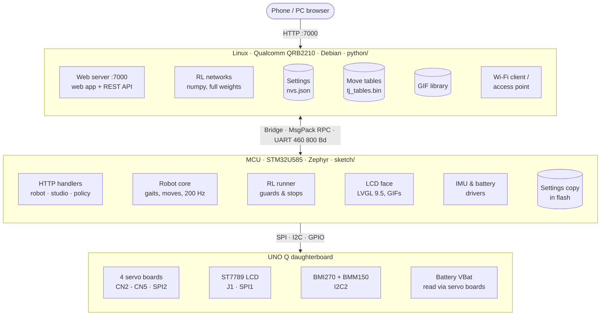

# Mini Pupper on Arduino UNO Q

Runs the Mini Pupper firmware (**firmware-dev**, written for the ESP32-S3) on an
**Arduino UNO Q** mounted on the Mini Pupper **UNO Q daughterboard**
(`Arduino_UNO_Q_EXT`), and serves the same web app.

- **Real-time control on the MCU** - gaits, servo frames, sensors, display and every RL safety rule.
- **Compute and connectivity on Linux** - web app, settings, RL networks, large move tables, Wi-Fi.
- **One codebase** - the robot, display and RL code is firmware-dev's own, ported by `tools/port_from_esp.py`.

## Architecture

### System overview

The two processors share no memory and no bus to the robot: **the MCU owns all
hardware**, Linux reaches it only through the Bridge. Anything with a deadline
stays on the MCU, so the robot stays safe when Linux is slow, busy or down.

### Responsibilities

| Concern | MCU - STM32U585 (`sketch/`) | Linux - QRB2210 (`python/`) |
|---|---|---|
| Motion | gaits, moves, 200 Hz servo frames, power / rest, look, joystick | streams TrajOpt / Character move rows |
| Servos | AT32 protocol on SPI2 (4 MHz), boot check, Servo Studio | - |
| Sensors | BMI270 + BMM150 IMU (remapped to the ESP board frame), battery voltage (read through the servo boards) | - |
| Display | ST7789 face, emotions, text, boot screens, GIF playback from RAM | GIF files, Display page settings |
| RL | 200 Hz ticks, observations, history, decoder, guards, stops, get-up, keep up, stairs | network evaluation (numpy, float weights) |
| HTTP | the ESP's `/v1/robot`, `/v1/studio`, `/v1/policy` handlers | web server, static app, Wi-Fi, system, display, diagnostics routes |
| Settings | a copy in flash, so the robot stands up before Linux boots | `nvs.json` (calibration, config, current caps, display) |
| Network | - | Wi-Fi client, fallback access point `MPX-Dog-XXXXXX` |
| Startup | starts at power-on from flash | App Lab app + `tools/mpx_start.sh` (re-flashes the MCU if unreachable) |

### Timing

| Loop | Period | Runs on |
|---|---|---|
| Servo frame / robot tick | 5 ms (200 Hz) | MCU |
| RL policy step | 20 ms (50 Hz) | MCU, network on Linux |
| RL network round trip | a few ms of the 20 ms step | Bridge + Linux |
| Settings sync | at start, then on change | Bridge |

### Software components

**MCU - STM32U585, Zephyr** (built with arduino-cli in *static* link mode: ~400 KB of
code run from the 768 KB flash partition). `shim_esp.cpp` maps the ESP-IDF APIs
(FreeRTOS tasks, `esp_timer`, NVS) onto Zephyr threads, so firmware-dev's code
compiles unchanged.

| Module | Files | Role |
|---|---|---|
| Robot core | `robot.cpp`, `moves_mpe_inc.h`, `stanford_gait.cpp`, `stanford_kinematics.cpp` | gaits, moves, servo frames, calibration offsets |
| Servo bus | `driver_board.c`, `spi_port.cpp` | AT32 servo boards, boot check, Servo Studio |
| IMU | `imu.cpp`, `imu_remap.cpp`, `bmi270.c`, `bmm150.c` | IMU readout and mount map |
| Power | `battery.cpp` | battery voltage, read from the AT32 servo boards |
| Display | `cap_display*.c`, `display_hw.cpp`, `mcu_display.cpp`, `gif_store.cpp` | face, emotions, GIFs (LVGL 9.5) |
| HTTP | `mcu_http.cpp`, `mcu_http_routes_inc.h`, `mcu_http_policy_inc.h` | robot, Studio and RL handlers |
| RL | `policy_run.cpp`, `policy_core.c`, `policy_files.c`, `policy_remote.cpp` | RL runner; policy files without weights; remote network call |
| Move streaming | `tj_stream.cpp` | receives move rows during a move |
| Settings cache | `nvs_cache.cpp` | settings copy in the MCU's flash |
| ESP-IDF shim | `shim_esp.cpp`, `shim_i2c.cpp` | ESP-IDF API on Zephyr |

**Linux - QRB2210, Debian** (an App Lab app, brick `arduino:web_ui`, port 7000).

| Module | Files | Role |
|---|---|---|
| Web server | `main.py`, `esp_api.py` | serves `assets/` (firmware-dev's `www/`), routes the API |
| MCU link | `mcu_link.py` | Bridge supervisor: hello, settings, IP, log, move rows |
| Settings | `nvs_store.py` | `nvs.json` |
| Display | `display_api.py` | `/v1/display`, GIF library and transfer |
| RL networks | `policy_net.py`, `policies/*.mpxp` | numpy evaluation |
| Wi-Fi | `tools/mpx_wifi.py`, `tools/mpx-wifi.service` | client and fallback AP |
| Autostart | `tools/mpx_start.sh` | starts the app at boot |

### Inter-processor interface (Bridge)

Arduino Router Bridge: MsgPack RPC over the internal UART `/dev/ttyHS1`, set to
**460 800 Bd** (Install, step 1).

| Function | Direction | Purpose |
|---|---|---|
| `mp_hello` | Linux &rarr; MCU | sketch version, servo boards, SPI, IMU, LCD, GIF, free RAM |
| `mp_nvs`, `mp_nvs_done` | Linux &rarr; MCU | settings at start |
| `mp_nvs_save` | MCU &rarr; Linux | a setting changed on the robot |
| `mp_http`, `mp_http_more` | Linux &rarr; MCU | forwarded HTTP request; reply in chunks |
| `mp_net` | Linux &rarr; MCU | IP and Wi-Fi state for the screen |
| `mp_tj_want` / `mp_tj_push` | MCU &rarr; Linux / Linux &rarr; MCU | request / deliver move rows |
| `mp_gif_want` / `mp_gif_begin`, `mp_gif_put`, `mp_gif_end` | MCU &rarr; Linux / Linux &rarr; MCU | request / deliver a GIF into RAM |
| `pol_obs_put`, `pol_fwd` | MCU &rarr; Linux | RL step: observation in, 12 actions out |
| `mp_spi`, `mp_imu`, `mp_imu_map` | Linux &rarr; MCU | diagnostics: servo bus, IMU, IMU mount map |
| `mp_log` | MCU &rarr; Linux | robot log lines (`/unoq/log`) |

### Fault behaviour

| Event | Result |
|---|---|
| Linux still booting | the robot stands up from the MCU's settings copy; the web app follows ~1 min later |
| New board, no settings copy yet | servos stay limp until Linux sends the settings (never stands on default calibration) |
| RL step not answered | the run stops as for a bad network output (graceful stop, or limp in a get-up) |
| App cannot reach the MCU at boot | `mpx_start.sh` re-flashes the MCU after one minute |
| Servo board missing at boot | shown on the screen for 30 s and in `/unoq/log` |

## Install / update

1. **Once: the Bridge at 460800 baud.** The face's GIFs and the RL policy need
   more than the router's default 115200. On the board:

       sudo systemctl edit arduino-router

   and put in the editor that opens:

       [Service]
       ExecStart=
       ExecStart=/usr/bin/arduino-router --unix-port /var/run/arduino-router.sock --serial-port /dev/ttyHS1 --serial-baudrate 460800

   then `sudo systemctl restart arduino-router`. (Without this the screen stays on
   "Linux is starting" and after 100 s says the router is not at 460800.)
   Check the line first with `systemctl cat arduino-router`: keep its own options
   and only add `--serial-baudrate 460800`.
2. **The MCU sketch is flashed with arduino-cli, not App Lab.** App Lab builds
   sketches in the core's "dynamic" mode, where the code is loaded into the
   MCU's 256 KB sketch RAM; this sketch (~400 KB of code: robot, LVGL, RL) does
   not fit there. In "static" mode it runs from the 768 KB flash partition.
   The app folder therefore has no `sketch/`: App Lab runs only the Python side
   and leaves the MCU alone. On the board:

       mkdir -p ~/mpx_mcu
       # copy the PC's mpx_unoq\sketch folder to ~/mpx_mcu/sketch (scp -r ... arduino@<IP>:/home/arduino/mpx_mcu/)
       cd ~/mpx_mcu/sketch && arduino-cli compile --upload .

   (`sketch.yaml` picks `link_mode=static,wait_linux_boot=no`: from flash, and
   starting at power-on.) Run this again whenever `sketch/` changes.
3. The Linux side: copy `python`, `assets`, `tools`, `app.yaml` to
   `~/ArduinoApps/mpx_unoq/` (and no `sketch` folder there), then
   `arduino-app-cli app restart ~/ArduinoApps/mpx_unoq`.
4. Make it start by itself at power-on (the start script is in `tools/`):

       cp ~/ArduinoApps/mpx_unoq/tools/mpx_start.sh ~/ && chmod +x ~/mpx_start.sh
       (crontab -l 2>/dev/null | grep -v mpx_start; echo "@reboot /home/arduino/mpx_start.sh > /home/arduino/app_autostart.log 2>&1") | crontab -

   It starts the app, waits until the app reaches the MCU, and only if it does
   not within a minute flashes the MCU again (`~/app_autostart.log` ends with
   "ready after start" when all went well). The face is up ~1 min after power-on.
5. Wi-Fi like the ESP (once): the robot opens its own network when it has none,
   and the web app's Wi-Fi page can scan / join / forget networks:

       sudo apt install -y dnsmasq-base      # usually there already
       sudo cp ~/ArduinoApps/mpx_unoq/tools/mpx-wifi.service /etc/systemd/system/
       sudo systemctl daemon-reload && sudo systemctl enable --now mpx-wifi

   With no saved Wi-Fi a minute after power-on (or when it drops for 30 s) the
   board opens the open network **MPX-Dog-XXXXXX** (XXXXXX: the board's machine-id, the same every boot) at 192.168.2.1;
   the screen shows "join MPX-Dog-XXXXXX 192.168.2.1". Join it with a phone, open
   http://192.168.2.1, and pick your Wi-Fi in Settings -> Wi-Fi. The AP goes down
   while the board joins (your phone drops off it); once joined, the screen shows
   the new address. A wrong password brings the AP back. With nobody on the AP for
   3 minutes it tries the saved networks again. Logs: `journalctl -u mpx-wifi`.
6. Calibration and settings live on the board, in `~/ArduinoApps/mpx_unoq/nvs.json`.
   Keep a copy on the PC (`scp arduino@<IP>:/home/arduino/ArduinoApps/mpx_unoq/nvs.json .`)
   and copy it back to a new board before the first start.

## Power-on: the screen and the web app

The robot stands up first: the MCU keeps a copy of the saved settings in its own
flash (`sketch/nvs_cache.cpp`, the core's storage partition), so a few seconds
after power-on the servos come up and the eyes appear, while Linux is still
booting. When the app connects it sends Linux's settings; a difference is written
to that copy and used from the next start. A new board has no copy yet: there the
servos wait for Linux the first time, and stand up at once from then on. The web
app and RL need Linux, so they are there about a minute later, as before.

The sketch is in the MCU's flash, so the screen comes up at once, before Linux:
"Mini Pupper / Linux is starting" with the seconds counting. Then:

1. "Linux is up - waiting for the robot app" (the router answered),
2. "Linux is up: 192.168.1.113:7000 ..." (the app's Python runs: the web app is
   being served from now on),
3. "Loading the saved settings" -> "Starting the servos" -> the eyes, with the
   address under them.

So the address under the eyes is the moment the web app is ready. The UNO Q's
Linux and App Lab's Docker take about a minute after the Arduino logo; that part
is the board's, the app cannot start earlier, but with step 4 it starts as soon
as App Lab can.

## Daughterboard

| | pins |
|---|---|
| Servo bus (SPI2) | D13 SCK, D11 MOSI, D12 MISO, **4 MHz** (`sketch/shim_esp.h` CONFIG_APP_SERVO_SPI_KHZ; the ESP runs 12) |
| Servo connectors | **CN2 = FL** (D10), **CN3 = FR** (D9), **CN5 = RR** (D7), **CN4 = RL** (D8) |
| LCD (ST7789, J1) | SPI1: A1 SCK, A3 MOSI, A0 CS; D5 DC, D4 RESET, D6 backlight (P-FET, low = on), 40 MHz |
| IMU | BMI270 + BMM150 on I2C2: D20 SDA, D21 SCL (address 0x68, or 0x69 if only that answers) |

Plug the legs into the connectors as in the table (the same legs as the wiring
before). "Current": the servo boards take their power straight from VBat on the
connectors now, so a weak supply no longer limits them through thin wires - there
is nothing to set in software for it.

At boot the ESP's boot check runs (each board's replies, the SPI line): a problem
shows on the screen for 30 s and in `/unoq/log`.

## Display page

As on the ESP: brightness, flip / mirror / shift, colours, emotions, text, and the
GIFs (blink, smile, sleepy, and your own up to 200 KB, 320 x 240). The GIF files
stay on Linux (`python/display_gifs/`, your uploads in `<app>/display/`); the
chosen one is sent into the MCU's RAM (a few seconds) and played from there.

## RL

The three policies firmware-dev builds in are here: the walk (`default.mpxp`,
"walk"), the SKU1 v2 recovery walker (`sku1v2_recovery`, the RL page's
Balance + get up / keep up) and its get-up (`getup_sku1`). The RL page works as
on the ESP.

The networks themselves (0.13 - 0.77 MB of weights each) do not fit the MCU: it
keeps the files without their weights (`sketch/policy_files.c`) and, at every
20 ms policy step, sends the observation to Linux, which evaluates the network
(`python/policy_net.py`, numpy, the full files in `python/policies/`) and answers
the 12 actions. Everything with a deadline stays on the MCU: the 5 ms ticks, the
servo exchange, the IMU, the tilt / current / temperature guards and the stops.
The RL page's "network" time is that round trip (a few ms; the step allows 20).
The recovery walker's 10-step history is kept on both sides; only the newest
observation goes over the Bridge.

- Needs the 460800 baud of Install step 1, and numpy (`python/requirements.txt`:
  App Lab installs it when the app starts the first time - the board needs
  internet then).
- Weights are always the file's floats (no 8 / 16-bit: Linux has the room). The
  size test (bench) measures the MCU, which has no room for big networks.
- The run and get-up logs cannot be saved as files (no file system on the MCU);
  the RL page shows them from memory. "Run without Wi-Fi" changes nothing here.
- If Linux does not answer a step, the runner stops the run as on the ESP for a
  bad network output (graceful stop, or limp in a get-up).

## Where things are kept

- `nvs.json` (app folder): what the ESP kept in NVS - calibration, config, current
  caps, rest timer, the display settings (`display.*`), controller scheme.
- `python/tj_tables.bin`: the TrajOpt / Character tables, streamed to the MCU while
  a move plays.

## Diagnostics

- `http://<board>:7000/unoq/hello` - the sketch: version, boards, SPI, IMU, LCD, GIF, free RAM.
- `http://<board>:7000/unoq/log` - the robot's log lines (the ESP's serial log).
- `http://<board>:7000/unoq/spi?edge=1&khz=4000` - servo bus clock / edge, live.
- `http://<board>:7000/unoq/imu` - the IMU: the mounting map, raw and mapped accel, and a check
  ("reads upright" when the robot stands flat). The robot reads the IMU in firmware-dev's ESP
  board frame; if the daughterboard holds the chip another way, teach it the map with two poses:
  `/unoq/imu/learn?pose=flat` (standing flat, still), then `/unoq/imu/learn?pose=nose_down`
  (back lifted, nose down 30-45 deg). It is saved (`imu.map`); `/unoq/imu/map?m=1,2,3` sets it by hand.

## Updating from firmware-dev

On the PC: `python tools/port_from_esp.py C:\esp\projects\firmware-dev` (robot,
display, RL, routes, Bosch drivers from its `managed_components`, cJSON kept as it
is in `sketch/`, the policies into `python/policies/`), and when LVGL
changes `python tools/vendor_lvgl.py C:\esp\projects\firmware-dev\lvgl`
(needs gcc). Copy `www/*` into `assets/`.
